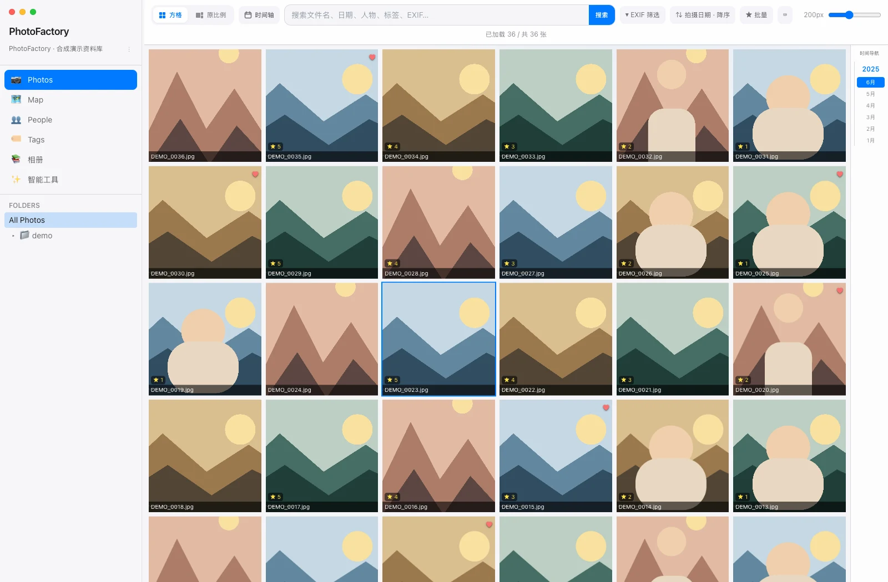
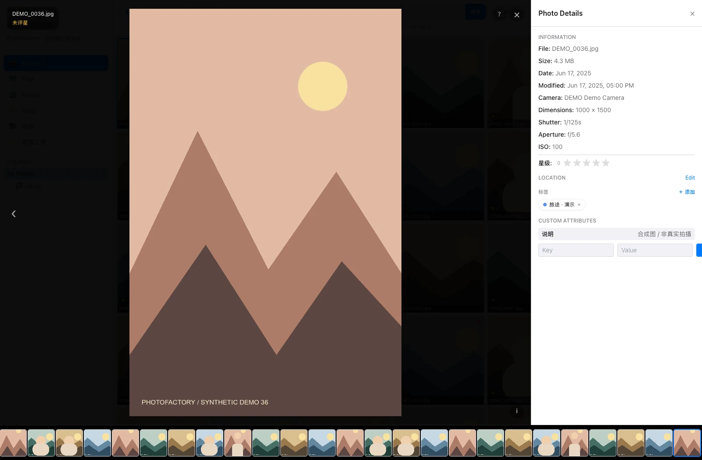
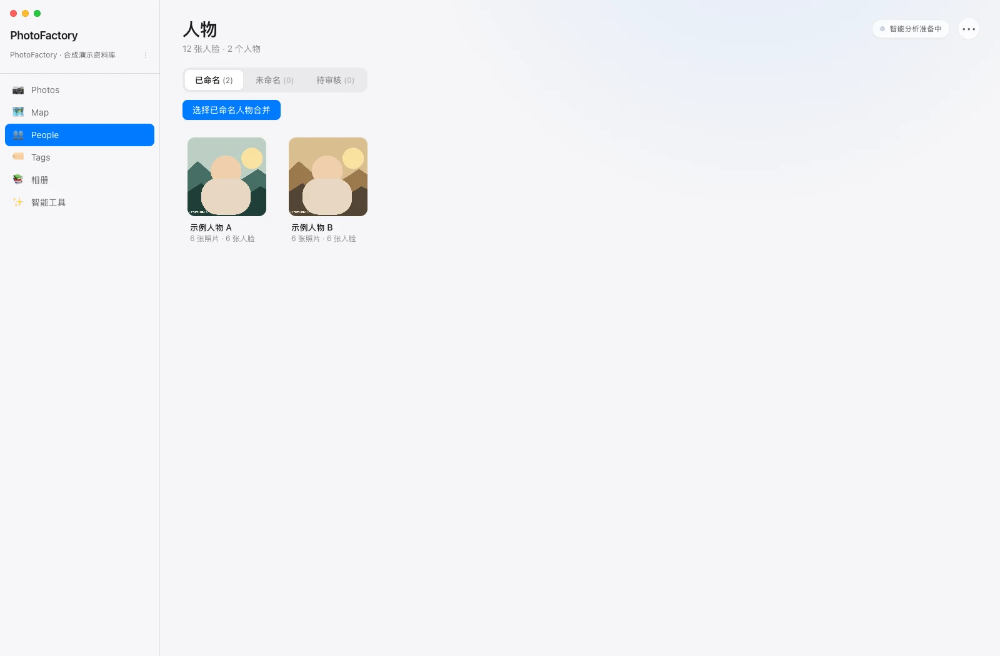
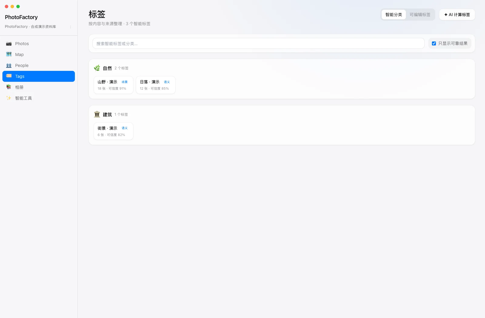
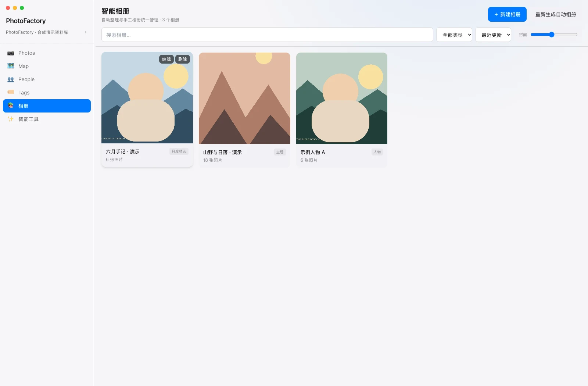
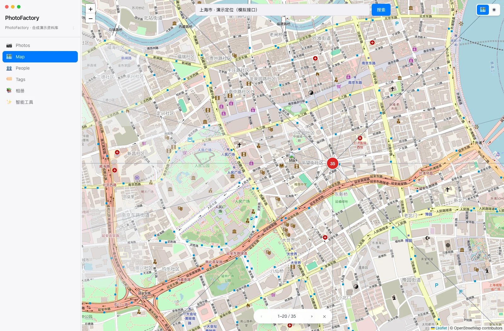
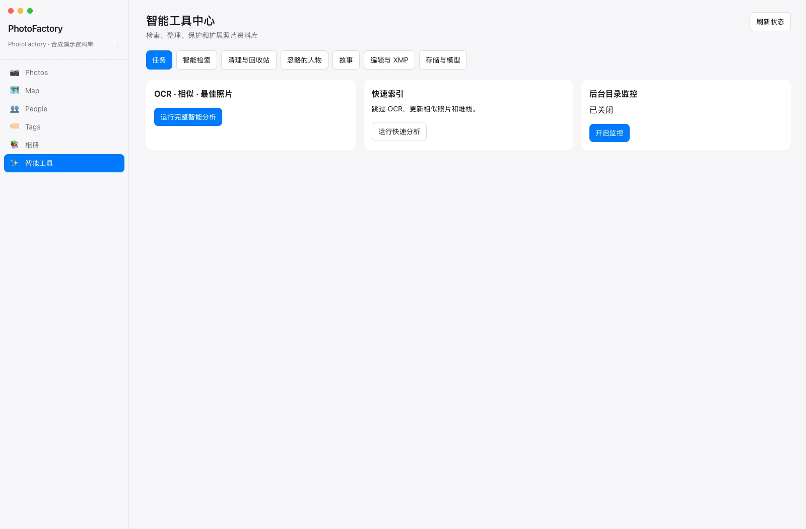

<p align="center"></p>
<h1 align="center">PhotoFactory</h1>
<p align="center">Keep photographs local. Find them by people, time, place and content.</p>
<p align="center"><a href="https://github.com/JackerKun/PhotoFactory">GitHub</a> · <a href="README.md">简体中文</a> · English · <a href="#interface-tour">Interface tour</a> · <a href="#development">Development</a> · <a href="docs/BUILDING.md">Build guide</a> · <a href="#data-and-limitations">Data and limitations</a></p>

PhotoFactory is a local-first desktop photograph manager built with Tauri 2, Rust, React and SQLite. Index a directory, browse photographs, combine search and EXIF filters, organize people and tags, inspect GPS locations and build albums. Photograph analysis runs locally.



**Screenshot provenance:** these are browser captures of the actual React components with mocked Tauri commands and 36 generated images. People, classifications, confidence scores, GPS, albums and metadata are seeded examples, not model predictions. They do not validate the native backend, Windows installers or AI accuracy. See [capture notes](docs/screenshots/README.md).

Version **0.1.1** is under active development. Try a copy of your photographs first. Pagination, virtualization and incremental processing are implementation mechanisms, not evidence of a completed 100,000-photo benchmark.

## Interface tour

| Workspace | Purpose |
| --- | --- |
| Photos | Directory indexing, incremental updates, square / proportional grids, timeline navigation, keyword and EXIF filters, sorting, favorites and ratings. |
| Viewer | Zoom, pan, folder filmstrip, metadata, tags and existing face results. Double-click a photograph, then press `I` for details. |
| People | Local face analysis, naming, merging, review and ignore / restore workflows. Automatic unnamed-person merging has candidate review and undo. |
| Tags | Scene and semantic results grouped by source; editable tags allow manual correction. |
| Map | Standard / satellite layers, address candidates, GPS photograph previews and individual / batch coordinate editing. |
| Albums | Time-, person-, place- and content-based organization with search and pagination. |
| Library tools | Jobs, intelligent search, similar-photo candidates, RAW+JPEG stacks, stories, trash, edit parameters, XMP and additional read-only storage sources. |













The [Chinese user guide](docs/USER_GUIDE.md) explains the workflows and keyboard shortcuts. Import indexes existing files rather than moving or copying them. Select the original directory containing `.pf/project.json` to reopen a project. Use incremental scanning when adding photographs instead of rebuilding every person group.

## Development

Prepare Node.js (CI uses 20), Rust stable, Python 3.10 / 3.11 and the platform's Tauri prerequisites. Windows needs C++ Build Tools and WebView2; macOS needs Xcode Command Line Tools. See the [build guide](docs/BUILDING.md).

```bash
cd PhotoFactory
npm ci
python3 -m venv ai_worker/.venv
ai_worker/.venv/bin/python -m pip install -r ai_worker/requirements.txt
ai_worker/.venv/bin/python ai_worker/download_models.py
npm run tauri dev
```

On Windows, use `ai_worker\.venv\Scripts\python.exe`. Running `npm run dev` alone starts only the frontend, without native scanning, SQLite commands or the AI Worker.

## Packaging and checks

```bash
# macOS
RUN_TESTS=1 ./build.sh macos

# Frontend checks
npm test
npm run build

# Native library tests
cd src-tauri
cargo test --lib
```

Windows builds use `build-windows.ps1`, or `build.sh windows` in Git Bash on Windows. Full packages include the standalone AI Worker and models; end users do not need Python. Build DMG and Windows installers / workers on their corresponding operating systems.

The workflow in `.github/workflows/release.yml` builds macOS Intel / Apple Silicon and Windows x64 / ARM64 on matching runners. Pushing a stable `vX.Y.Z` tag publishes a Release only after all four builds, tests and artifact integrity checks pass. Manual branch runs produce Actions artifacts only. Models are downloaded and validated in CI; they do not belong in Git. Windows ARM64 uses a native ARM64 app with an x64 AI Worker under Windows 11 emulation; 32-bit Windows is unsupported. See the [release guide](docs/BUILDING.md#6-github-actions-四架构构建与-release). Local ad-hoc signing is not Developer ID signing or Apple notarization. This README does not advertise local build paths as public downloads.

For this documentation update, the macOS frontend passed **29 tests across 11 files** and the TypeScript / Vite build. Existing bundle-size warnings remain. Native AI, Windows and large-library acceptance testing were not performed for this documentation task.

## Data and limitations

- The photograph root contains `.pf/project.json`, `photos.db`, thumbnails, map tiles and AI caches. Back up both originals and project data. The database also holds user organization; deleting `.pf/` loses more than disposable previews. Close the application before a file-level SQLite backup.
- Local models need initial preparation / downloads. Recognition and similarity suggestions need human review.
- Maps and address search contact OpenStreetMap, Esri or Nominatim; requested areas / queries go to the service. Cached tiles can be reused offline.
- OCR optionally uses system Tesseract and installed language data. Writing edited GPS back to originals requires ExifTool and an explicit write operation; storing coordinates in the project database is separate.
- HEIC / HEIF, RAW, PSD, XCF and EXR preview support depends on platform decoding and installed dependencies.
- The edit workspace stores parameters. Do not interpret it as a complete RAW development or rendered-output pipeline.
- Additional storage sources can be indexed read-only. Preserve original backups before testing cleanup or metadata-writing workflows.

Source layout: `src/` frontend; `src-tauri/` native application; `ai_worker/` local analysis; `docs/` usage, building and provenance; `tools/screenshots/` optional documentation capture tooling. See the [change log](docs/CHANGELOG_2026-10-30.md) and [face evaluation notes](docs/FACE_EVALUATION.md).
