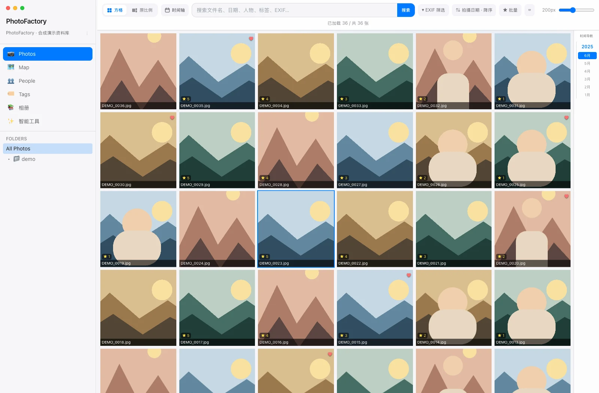
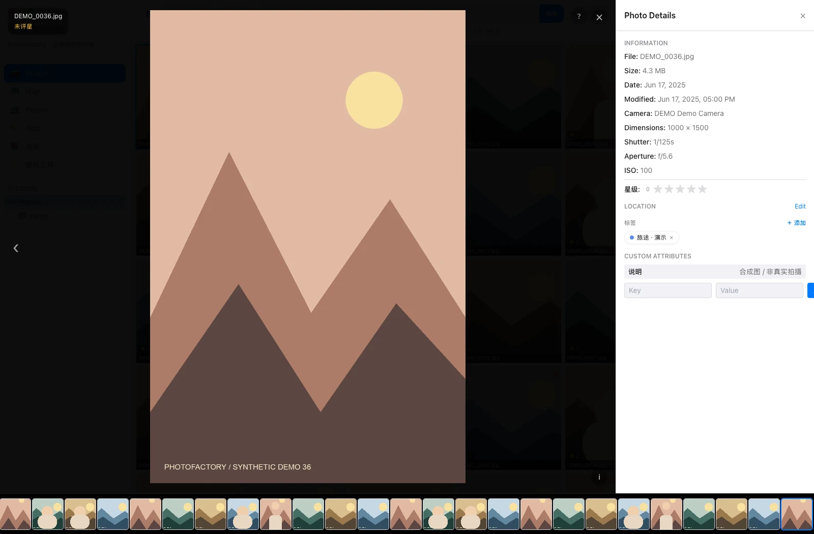
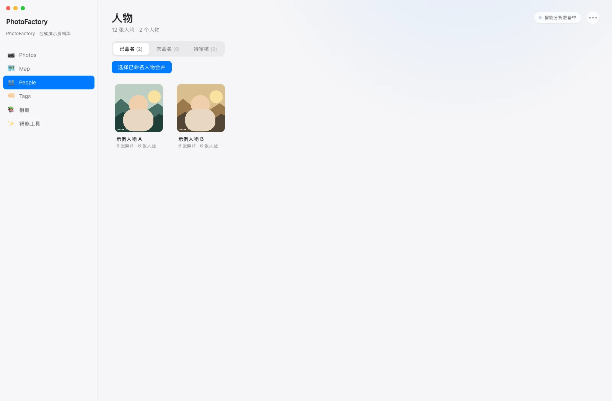
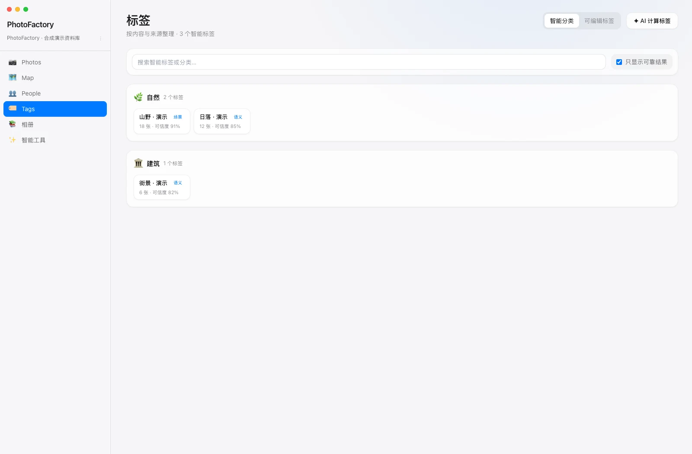
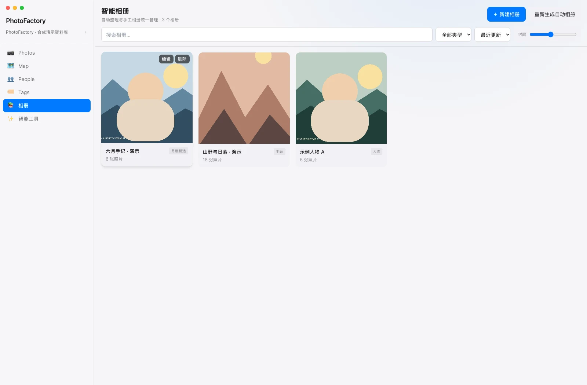
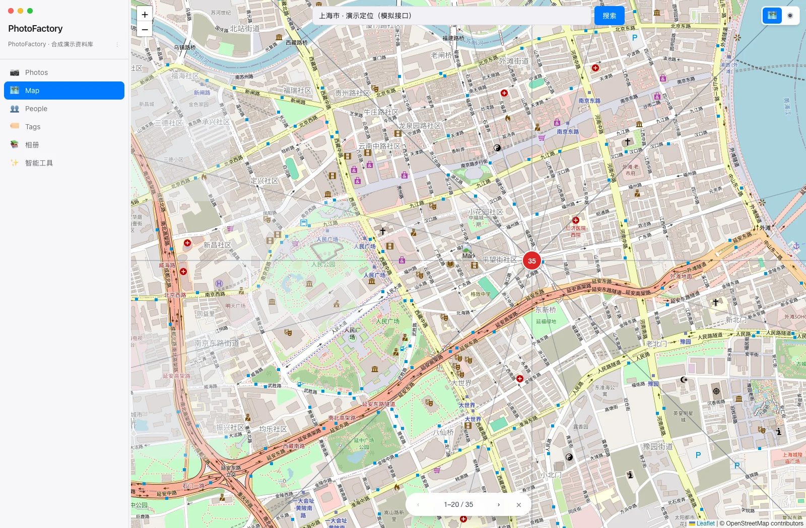
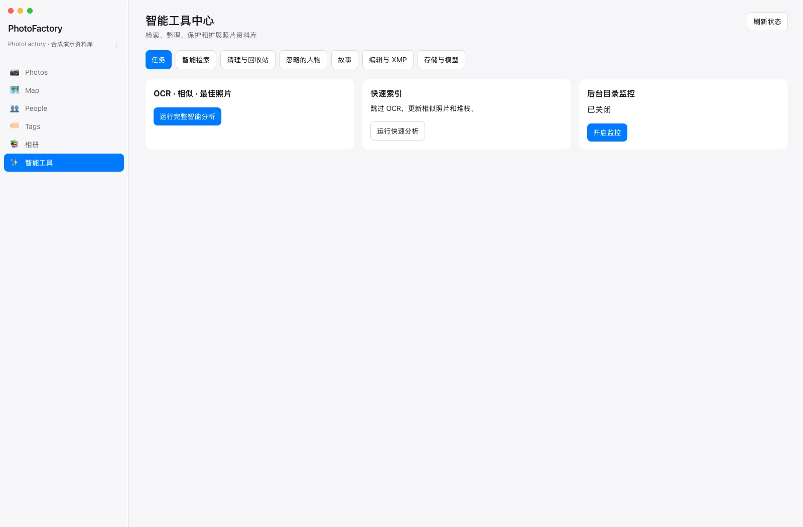

<p align="center">
  
</p>
<h1 align="center">PhotoFactory</h1>
<p align="center">让照片留在本地，把人物、时间、地点和内容整理在一起。</p>
<p align="center">
  简体中文 · <a href="README.en.md">English</a> ·
  <a href="https://github.com/JackerKun/PhotoFactory">GitHub</a> ·
  <a href="https://github.com/JackerKun/PhotoFactory/releases">安装包</a> ·
  <a href="#界面导览">界面导览</a> ·
  <a href="#快速开始">快速开始</a> ·
  <a href="docs/USER_GUIDE.md">使用手册</a> ·
  <a href="docs/BUILDING.md">构建与发布</a> ·
  <a href="#数据与兼容边界">数据与兼容边界</a>
</p>

PhotoFactory 是使用 Tauri 2、Rust、React 和 SQLite 构建的本地照片管理桌面工具。选择照片根目录建立索引，用时间、人物、地点、内容标签、器材和星级寻找照片，再通过智能相册与工具中心继续整理。原片无需为了 AI 分析而上传。



_截图为真实 React 组件的浏览器演示，使用独立模拟命令接口和 36 张本地生成图片。人物、标签、GPS、相册及器材信息均为预置示例，不是实际 AI 推理结果，也不是 Tauri / Rust 端到端测试。完整说明见[截图来源](docs/screenshots/README.md)。_

当前版本为 **0.1.6**。项目仍在开发中，建议先用照片副本评估格式、目录权限和 AI 效果，再接入正式资料库。分页和增量机制用于控制大资料库开销，不等于已经完成真实十万张照片的性能验收。

## 可以做什么

| 工作区 | 主要用途 |
| --- | --- |
| **Photos / 照片** | 目录扫描与增量更新、方格 / 原比例网格、滚动年月导航、关键词与 EXIF 组合筛选、多字段排序、收藏及 0–5 星评分。 |
| **大图与详情** | 缩放和平移、底部胶片条、器材与 GPS 信息、标签、自定义属性，以及已有的人脸结果。 |
| **人物** | 本地人脸分析、命名、合并、待审核与忽略 / 恢复。可按人数和人物组合查找合影，也可预览并撤销未命名人物的自动合并。 |
| **Tags / 标签** | Places365 场景和 CLIP 多标签结果按类别 / 来源展示；可编辑标签独立管理，允许人工修正。 |
| **地图** | 标准和卫星图层、离线地图导入和导出、GPS 照片预览、拍摄轨迹、地址检索及批量坐标编辑。 |
| **相册** | 按人物、时间、地点和内容组织智能相册；支持搜索、分类、排序和分页查看。 |
| **智能工具** | 任务、智能检索、相似照片、RAW+JPEG 堆栈、故事、回收站、编辑参数、XMP 和附加只读存储源。 |

图库采用分页读取、接近屏幕时加载缩略图和增量分析。人脸及分类结果存于项目中；新增或变化的文件进入后续处理，未变化文件不重复分析。识别与相似分组仍需人工复核，不能保证自动结果准确。

## 界面导览

以下图片只展示界面入口与布局。截图工具以别名替换原生命令桥接，不打开个人图库、不运行 AI Worker，也不把模拟数量、可信度或人物分组作为识别效果宣传。

### 照片浏览：先选目录，再组合筛选

选择 **Photos / All Photos** 查看项目照片。用顶部关键词、EXIF 筛选、星级和排序缩小范围；方格和原比例均可调整密度。右侧年月导航跟随当前结果，点击月份用于滚动定位，顶部时间轴则用于筛选。

### 大图与详情：照片、信息一起看

单击照片打开详情，双击进入大图；`I` 切换详情、`F` 收藏、`0–5` 评分、`Esc` 返回。大图底部胶片条按当前文件夹浏览，先显示可用缓存，在平台支持时加载原图。



### 人物：自动分组后，仍能人工整理

进入 **人物** 查看已命名、未命名和待审核分组。可以命名、确认、合并或忽略结果。自动合并未命名人物时可先预览候选。点 **合影** 按人数或所选人物查找照片。完整重建会保留已命名人物。更多细节见[使用手册](docs/USER_GUIDE.md)。



### 标签：查看来源，也能自己修正

进入 **Tags**，在“智能分类”查看内容分类、来源、数量与可信度；切到“可编辑标签”创建、修改或删除标签。模型输出属于候选信息，人工标签与照片属性可继续独立管理。



### 相册：按主题继续回看

进入“相册”查看按时间、人物或主题组织的列表，点开查看照片。相册中的筛选与排序入口用于继续寻找内容。



### 地图：查看 GPS 照片与拍摄轨迹

进入 **地图**，切换标准或卫星图层，点击聚合点查看照片。首次打开显示世界地图，后续恢复上次的位置和缩放。优先使用本地瓦片，覆盖不足时尝试联网补充。地址搜索需要联网。

点右上角的 **拍摄轨迹**，框选范围，按需指定日期后生成轨迹。轨迹按拍摄时间连接 GPS 照片，可保存到当前照片库。点轨迹上的圆点会展开附近照片的缩略图，每张缩略图都有细线连回拍摄位置，点击可看大图。点面板标题旁的箭头可折叠面板，继续在地图上浏览轨迹。底图加载失败时，可点左下角的刷新图标重试。



### 智能工具：集中处理任务与整理工作

进入“智能工具”，按页切换任务、检索、相似分组、堆栈、故事、回收站与设置。编辑页当前保存旋转、曝光、对比度、色温等参数，不能把它等同于完整 RAW 显影或成品渲染导出流程。



侧栏的 **后台任务** 集中显示缩略图和 AI 分析进度。缩略图提供低速、均衡和全速三档。兼容设备可用 GPU 缩放预览，并在不支持时回退到 CPU。侧栏底部可切换浅色、深色或跟随系统主题。

## 快速开始

### 日常使用

1. 启动完整构建的 PhotoFactory 桌面应用，点击“导入照片”。
2. 输入项目名称并选择照片根目录，勾选要扫描的格式。
3. 等待索引与缩略图生成；AI 结果随后台分析逐步出现，首次模型加载可能较慢。
4. 在 Photos、People、Tags、Map、相册之间浏览；对人物、标签、坐标和相似组进行人工复核。
5. 后续追加文件时，用项目菜单的“增量扫描新照片”，无需为每次增量完整重建人物。

导入扫描建立索引，不移动或复制原片。项目在根目录创建 `.pf/`；打开已有项目时，选择包含 `.pf/project.json` 的原照片目录。附加 NAS / 移动硬盘可在“智能工具 → 设置”中作为只读来源登记并扫描。

### 从源码开发

准备 Node.js（项目工作流使用 22）、Rust stable、Python 3.10 / 3.11，以及操作系统所需的 Tauri 原生构建依赖。Windows 还需要 C++ Build Tools 与 WebView2，macOS 需要 Xcode Command Line Tools。完整清单见[构建指南](docs/BUILDING.md)。

```bash
cd PhotoFactory
npm ci

# 首次准备本地 AI 环境（以下为 macOS / Linux 路径）
python3 -m venv ai_worker/.venv
ai_worker/.venv/bin/python -m pip install -r ai_worker/requirements.txt
ai_worker/.venv/bin/python ai_worker/download_models.py

npm run tauri dev
```

也可以在根目录一键准备并启动完整桌面开发环境：

```bash
./start.sh
# 仅检查本机依赖和模型，不安装或启动
./start.sh --check
```

Windows 请使用 **Git Bash**，并安装原生 Windows Node.js、Rust/MSVC、Python 3.11 x64、WebView2（详见 [构建指南](docs/BUILDING.md)）；不要在 WSL 中启动 Windows 桌面验证。脚本会安装前端/Python 依赖、下载或校验 AI 模型，并启动 Tauri 桌面程序；人脸和场景分析由应用按需启动 AI Worker，退出应用时关闭。首次运行需要联网下载依赖和模型。OCR 需要 Tesseract 及 `eng`、`chi_sim` 语言包，EXIF/GPS 回写需要 ExifTool；缺少时脚本会提示，相应功能需补齐依赖后验证。

Windows 图片显示修复涵盖 `http://asset.localhost`、项目目录/额外存储源授权及 `.pf` 隐藏缓存；HEIC/RAW 使用 Worker 内置的跨平台解码器生成预览。验证时请打开位于 D:/E: 或网络盘的照片库，查看缩略图、双击大图并运行人脸识别。已经安装的旧版本需重新运行 `build-windows.ps1` 构建并安装，`start.sh` 则直接验证当前源码。

Windows 虚拟环境使用 `ai_worker\.venv\Scripts\python.exe`，其余步骤参阅构建指南。`npm run dev` 只启动前端服务，原生扫描、SQLite、文件对话框和 AI 由 Tauri / Worker 提供；直接打开前端不等于完整桌面程序。

## 离线地图

在联网电脑运行 `./startOffline.sh`，浏览器会打开独立工具。缩放和平移即可保存已浏览的瓦片，也可以框选范围。选择标准或卫星图层可导出 `.mbtiles`，选择两种地图可导出 `.pfmap`。在 **地图 → 离线地图 → 导入离线地图包** 中导入后，包存入当前照片库的 `.pf/maps/offline/`。也可以从 PhotoFactory 导出已导入和已缓存的瓦片。详见[打包和导入指南](docs/OFFLINE_MAPS.md)。

## 安装包与构建

当前仓库提供本地构建脚本与 macOS / Windows 四架构 CI。发布成功后可从 [Releases](https://github.com/JackerKun/PhotoFactory/releases) 下载；工作流配置不等于已经产生安装包，也可按下列步骤自行构建。

| 平台 | 构建方式 | 默认输出 |
| --- | --- | --- |
| macOS | `RUN_TESTS=1 ./build.sh macos` | `src-tauri/target/release/bundle/dmg/*.dmg` |
| Windows PowerShell | `.\build-windows.ps1` | `bundle/msi/*.msi`、`bundle/nsis/*-setup.exe` |
| Windows Git Bash | `RUN_TESTS=1 ./build.sh windows` | 同上，需在 Windows 主机运行 |

完整构建会将独立 AI Worker 与所需模型打入安装包，日常使用无需另外安装 Python。macOS 与 Windows 安装器和 AI Worker 在对应系统构建。CI 覆盖 macOS Intel / Apple Silicon、Windows x64 / ARM64；Windows ARM64 主程序原生编译，内置 x64 AI Worker 通过 Windows 11 兼容层运行，不支持 32 位 Windows。

`.github/workflows/release.yml` 在推送 `vX.Y.Z` 标签后测试并构建四个目标；全部成功且校验通过，再将 5 个安装包、SHA-256 清单和架构 manifest 上传到 Release。模型在 CI 下载并验证，无需提交到 Git。手动分支运行仅上传 artifact。版本必须与项目及锁文件一致，操作步骤见[发布指南](docs/BUILDING.md#6-github-actions-四架构构建与-release)。macOS ad-hoc 签名不等同于 Developer ID 签名与 Apple 公证，Windows 当前也没有发布者签名。

## 数据与兼容边界

### 项目数据和备份

```text
<照片根目录>/.pf/
├── project.json
├── photos.db
├── thumbnails/{small,medium,large}/
├── maps/tiles/
├── maps/offline/
└── ai_cache/{faces,tags}/
```

原片和 `.pf/` 应分别纳入备份：数据库不仅是可重建缓存，还保存标签、人物整理与其他项目状态。不要用“删除 `.pf/`”作为常规清理方法。手工文件级备份前先关闭应用，避免遗漏 SQLite WAL 中尚未合并的数据。最近项目路径还会写入系统应用配置目录。

### 联网、外部工具与格式

| 情况 | 实际边界 |
| --- | --- |
| 本地 AI | 照片在本机处理；首次准备模型和依赖需要下载。识别准确性取决于照片、模型与阈值，结果可人工整理。 |
| 地图与地址 | 使用 OpenStreetMap、Esri World Imagery、Nominatim 等服务，对应区域 / 查询会发给服务商；已缓存瓦片可离线复用。 |
| OCR | 可选依赖系统 Tesseract；中文语言包缺失时可能降为英文，未安装时不应期待文字识别结果。 |
| GPS 写回 | 编辑坐标可保存到项目数据库；同步回原片依赖 ExifTool，并且属于显式文件写入。只读来源应继续保持只读。 |
| 格式 | 常见 JPEG、PNG、WebP 等可扫描；HEIC / HEIF、RAW、PSD、XCF、EXR 的解码和预览依平台及依赖，不保证全部编码可用。 |
| 相似与最佳照片 | 候选分组和评分辅助人工选择，不应未经检查直接清理唯一原片。 |
| 性能 | 分页、虚拟网格、候选分桶和增量管线减少无谓开销；首次扫描、模型加载及预览仍消耗 CPU、内存和磁盘。 |

详细日常操作见[使用手册](docs/USER_GUIDE.md)；人物评估边界见[人脸评估说明](docs/FACE_EVALUATION.md)。

## 验证与维护

```bash
npm test
npm run build
cd src-tauri
cargo test --lib
```

GitHub 上的安装包构建、测试结果和临时下载文件可在 [Actions](https://github.com/JackerKun/PhotoFactory/actions/workflows/release.yml) 查看。

## 项目结构

```text
src/                  React、TypeScript 前端与组件测试
src-tauri/            Rust、SQLite、缩略图、原生命令与打包配置
ai_worker/            Python / ONNX 本地分析服务
docs/USER_GUIDE.md     日常使用手册
docs/BUILDING.md       环境准备、Worker 与安装包构建
docs/screenshots/     演示截图、来源与复现说明
build.sh              macOS / Windows Git Bash 构建入口
build-windows.ps1     Windows PowerShell 构建入口
start.sh              桌面开发启动入口
startOffline.sh       浏览器离线地图工具入口
.github/workflows/    macOS / Windows 四架构构建与 Release
```

技术栈：Tauri 2、Rust / Rayon / Tokio、React / TypeScript / Zustand、SQLite、Leaflet / Supercluster，以及 RetinaFace、ArcFace、Places365、量化 CLIP 与可选 Tesseract。历史功能变更见 [2026-10-30 更新记录](docs/CHANGELOG_2026-10-30.md)。
